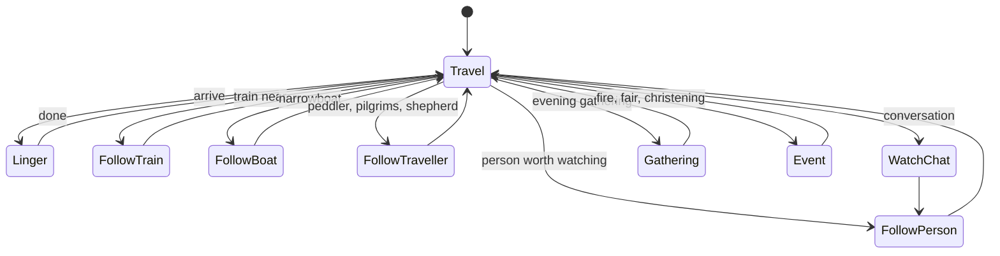

# The autopilot

Code: `src/app/director.rs` and `director/`, `src/app/story.rs`, `src/camera.rs`,
`src/app/hud.rs` (postcards), `src/app/skyshow.rs`.

The camera is run by a **director** (`Director`, defined in `src/app.rs`). While
`auto` is on it picks something to watch, flies there, films it, and picks again. Any
manual input (drag, keys, wheel) pauses it for 25 seconds; Space toggles it.

## Camera (`camera.rs`)

An **orthographic isometric** camera. State: `target` (a world point), `yaw`,
`pitch`, `zoom` (half the visible height in world units), `aspect`. The eye sits
`DIST = 300` back (more when zoomed far out so nothing is clipped).

- `view_proj(px_h)` returns the view-projection matrix and, when chunky pixels
  are in use, snaps the target to the pixel grid so pixels do not crawl; it also
  returns the sub-texel shift the upscale must undo so motion stays smooth.
- `ground_rect()` is the axis-aligned ground rectangle covering everything on
  screen between heights 0 and 70 (what chunk streaming loads).
- `view_radius()` is how far out life should be simulated (capped at 300 by the
  frame loop).
- `ground_axes()` gives the ground-plane right/forward vectors for panning;
  `basis()` the camera right/up; `back()` the direction to the eye;
  `depth_range()` the linear depth between near and far planes.

## Modes

| Mode | What the camera does |
| --- | --- |
| `Travel` | Pans towards a destination, zooming out first for a long pan and in on arrival |
| `Linger` | Holds a place with a `Shot` (see below), waits for the thing it came for |
| `FollowTrain` | Rides along a train (clicking a train follows it for good; turning the view with Q/E on a train is kept) |
| `FollowPerson` | Follows a villager; stays with them through a chat |
| `FollowBoat` | Drifts alongside a narrowboat |
| `FollowTraveller` | Walks with a peddler, pilgrims or shepherd |
| `WatchChat` | Leans in on a conversation near the middle of the view |
| `Gathering` | Committed to one evening gathering: wide enough to see folk leave their houses, then close in once dancing starts, a slow drift round the ring |
| `Event` | Something is going on in a town (fire, fair, christening, wedding) |

A **`Shot`** says how a place is filmed: `Orbit` (circle slowly), `Push` (start wide
and push in), `Hold` (a low steady angle).

## Choosing a destination (`candidates.rs`, `travel.rs`)

`candidates()` lists everywhere within reach, each as a `Cand { pos, id, kind,
weight, why, wait, promise }`:

- **Towns** and **cities**, weighted by what their `forecast` says the town will be
  doing when the camera would arrive (it estimates arrival from the camera's pan
  speed): market day, the fair, a wedding, a christening, trouble, the evening
  gathering, cricket, a snowball fight. It skips occasions that bad weather will
  prevent. `wait` is the hour the thing begins if the camera would be early;
  `promise` is what the town is told (see Visits in [Simulation](simulation.md)).
- **The next chapter of a story** (weight 3.8).
- **Countryside sites** (weights vary with the time and weather): the lighthouse at
  night, in fog (foghorn) or a storm; harbour at dawn and dusk; windmill in a wind;
  watermill in rain; haunted ruins after dark or in fog; standing stones at dawn;
  chalk figure; geyser; oasis caravan; mine; ski resort in winter; monastery bell
  at 6/12/18; shrine lamp at night; hill fort at dusk; camp at dusk; orchard
  during apple picking; apiary in fine summer daylight.
- **Weirs** (salmon in autumn), **railway places** (junctions, crossings,
  passing loops, the nearest six), **canals**, and **wild country** (dunes, frozen
  moors, high mountains) in 16 directions at ~330–450 units.

`start_travel` scores each candidate (`weight × 1.35`, a flavour bonus that favours
the unusual and marks towns down, a bonus for continuing in the same heading,
distance falloff, a little randomness, a penalty for repeating the last one or two
kinds), skipping places visited lately (a ring of 10) and anything under 120 units
away. Every so often (after 4 legs, 35% chance; always after 8) it makes a **long
journey**: a far candidate chosen with `far_candidate`, flown high and wide
(zoom 55–75, steep pitch) with a 120-second commitment. Otherwise a story may
begin (30% chance after 2 legs) and the next leg zooms 24–34 with a pitch of
0.55–0.7. The HUD announces "Heading for: …".

`arrive()` picks a `Shot`, waits for what the place was chosen for if it has not
started, and sets the lingering time. At a haunted ruin in the dark it stays with
the ghost and chooses the best camera angle (`best_ghost_yaw` walks a line of sight
through the real blocks from the ghost's path in every direction and prefers the
front).

## Steering (`steer.rs`)

`direct(dt)` runs every frame. In outline:

- Commitments first: a wedding or christening the camera promised to attend
  (`committed()`) keeps it there; gatherings outrank following people, chats and
  trains; events are watched once per sort per day, the weightier ones overriding
  the current shot (`watch_gatherings`, `watch_events` in `watch.rs`).
- Opportunistic interest while travelling or lingering: a conversation nearby
  (`WatchChat`), a narrowboat, travellers on the road, trains passing close.
- When the target of attention ends (a dog caught, a chat over, a crowd gone home),
  `look_around` pulls back to find something pleasant nearby, wildlife first and
  boats only if nothing else, otherwise lifts the view to take in the land.
- Wedding shots (`wedding_shot`) stay with the couple as they gather, walk to
  church and come out, seen from the front of the church.
- Heading and yaw: a slow swing of up to a quarter turn either way, easing round
  (gentler in chunky mode, where rotating pixels shimmers). A rainbow pins the
  heading while it lasts. A postcard looks out towards the horizon rather than
  down.
- Zoom and pan are blended with exponential smoothing (`approach`). A long pan
  zooms out first, pans, then zooms back in. A lighthouse is framed whole
  (`LIGHTHOUSE_ZOOM`, `LIGHTHOUSE_LIFT`).
- The autopilot frames everything `TIGHTER = 0.85` closer than the director's
  numbers say, so those numbers read as written.

## Day change and rebuilds (`watch.rs`)

When the game day changes, the director updates the planner's `day`, finds lots
whose construction stage changed, and has the world rebuild the chunks they touch
(see [Chunks and meshing](chunks-and-meshing.md)).

## See-through (`see_through_foci`)

While the autopilot watches particular people it fades whatever stands between
the camera and them. `see_through_foci` returns circles `(x, y, z, radius)` round
each watched person (or one around a whole wedding party) which are sent to the
renderer in `Frame.foci`; the scene shader drops fragments of buildings and trees
that are inside the line of sight and the mask pass draws an outline of what was
removed. The fade factor `see_through` eases in and out. Not for a house fire (the
burning house is the thing to see); postcards (other than of a festival) clear
nothing. The same mechanism lifts the roof off a house when you zoom right in
(`peek`).

## Stories (`story.rs`)

Instead of only hopping between the best sights of the moment, the autopilot
sometimes follows one town's occasion across a few days. `Story::plan` looks at the
`forecast` of every town within 800 units for the next two days and picks an
occasion with weight ≥ 2.2 (wedding, christening, fire, gathering) within 700
units. Its beats:

1. **The eve** (17:00–21:00, the day before): "The eve of a wedding: X makes ready",
   with lamps coming on.
2. **The day itself**: the occasion, with a `Promise` so the town holds it for the
   camera.
3. **The morning after** (07:00–10:00).

The camera sets off `LEAD = 3` game hours early. A story whose chapters have gone
by is dropped. The HUD shows "Chapter N of M · title: why".

## Postcards (`hud.rs`)

Now and then (`POSTCARD_GAP = 150` seconds apart, held `POSTCARD_HOLD = 10`) the
autopilot holds still on a lovely view and captions it: a rainbow, northern lights,
a clear sunset (18:12–19:24) or dawn (5:48–6:48), snow falling on a town, a
festival, a full moon. The look is a shallower, softer focus eased in and out, and
the HUD hides.

## Sky show (`skyshow.rs`)

- **Rainbows**: stand in the world a little beyond where the camera was looking
  when it appeared, sized to the view; the director keeps its heading while one
  lasts.
- **Northern lights**: curtains fixed to the world over a lattice (`curtains_in`),
  deterministic per world, nearest eight sent to the shader (`curtains_near`).
  `?aurora` forces them.
- **Shooting stars** (`meteor`, `meteor_t`).
- `light_matrix` builds the sun's orthographic view for the shadow maps, quantised
  so the view moves in whole texels.
