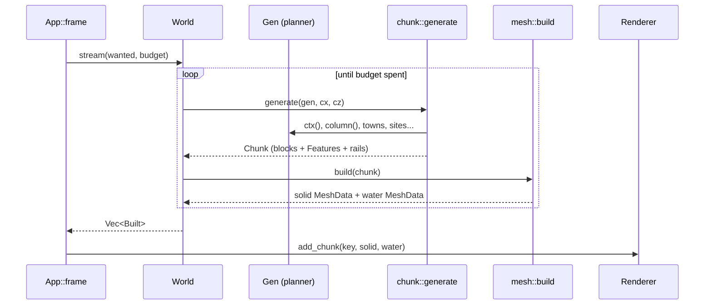

# Chunks and meshing

Code: `src/world/mod.rs`, `src/world/chunk.rs` and `chunk/`, `src/world/mesh.rs`,
`src/world/blocks.rs`.

## Streaming

`World` (`world/mod.rs`) owns the `Gen` planner and a map of loaded chunks keyed
by `(cx, cz)`. A chunk is `CS = 32` columns square and `CH = 64` voxels tall.
Only the chunk's **`Features`** are kept after meshing; the voxel array is
dropped.

Each frame `stream_world` (`app/frame/stream.rs`):

1. takes the ground rectangle visible on screen, padded by 16 units;
2. lists the chunks it covers, sorted nearest-the-camera first;
3. calls `World::stream(wanted, budget_ms, now)` which generates and meshes
   missing chunks until the time budget is spent. The budget is 40 ms until the
   chunk under the camera has been uploaded (so the first view appears fast),
   then `Quality::mesh_budget()` (7 ms; 3 ms on tiers 4–5);
4. uploads each new chunk's solid and water meshes to the renderer;
5. evicts chunks more than two chunks outside the wanted range and frees their
   GPU buffers.

When streaming produces nothing new and some chunks are loaded, the world is
`settled`. That flag lets animals spawn out of sight rather than anywhere, the
house peek-in effect switch on, and a returning visitor be greeted.

## Chunk generation (`chunk.rs`)

`chunk::generate(gen, cx, cz)` builds a `Chunk`:

- `blocks`: a padded array `(CS+2)² × CH` (a one-voxel border copied from the
  neighbours' *plan*, not from loaded neighbours, so meshing can cull faces and
  compute ambient occlusion with no lookups into other chunks);
- `feat`: `Features`, the things the simulation and renderer need later;
- `rails`: `RailSeg` ribbons for track (see below).

The steps, in order:

1. **Terrain** (`chunk/terrain.rs`): for each column in the padded area, evaluate
   noise four at a time and fill grass/dirt/stone/sand/snow/water by biome and
   height (`fill_column`); paint roads, streets, plazas, paths,
   canal channels and towpaths, railway beds, viaduct piers and arches, tunnel
   mouths and portals, bridges and their decks.
2. **Trees and plants** (`chunk/trees.rs`): per-biome trees (oak-ish, pine,
   birch), bushes, rocks, flowers, tall grass, cacti, reeds. They are placed by
   hash, never within the town, a road, a rail, a green and so on.
3. **Rails**: track is not voxels. Each step along a line (and each junction
   chord) becomes a `RailSeg` ribbon that follows the line's curve and smooth rail
   height; `mesh.rs` turns it into ballast, sleepers and steel rails.
4. **Towns** (`chunk/town.rs`, `chunk/lots.rs`): for every town near the chunk,
   `build_town` lays plaza, fountain, bench, market stalls (city), well, lamp
   posts, street trees and the lot buildings by kind (house, apartment, tavern,
   bakery, smithy, shop, church, farm, garden, school, library), with a house's construction `Stage` (plot pegs, scaffolding, frame,
   done, ruin). `build_plaza` makes the fountain (a stone basin with flower
   planters and a tiered column), benches and market stalls; rail towns also
   get a platform with a short canopy (`build_station`).
5. **Ferries**: landings and a `Features.ferries` record, in the chunk containing
   the first landing.
6. **Weirs** (`chunk/weirs.rs`): the sill across the river.
7. **Countryside sites** (`chunk/sites/`): `buildings.rs` (windmill, manor,
   watermill, quarry, mine, lighthouse, harbour), `landmarks.rs` (ruin, stone
   circle, chalk figure, geyser/oasis pool, ski resort) and `country.rs` (orchard,
   apiary, monastery, shrine, hill fort, camp). They also push features (sail
   hubs, wheel hubs, beacons, bells, steams, piers).
8. **Anglers** (`chunk/anglers.rs`): fishermen on river banks, placed once
   everything that could stand there is built.
9. **Pasture**: a chunk with `nature > 0.6` has a 25% chance of one pasture spot
   on plains or forest where livestock will graze.

### `Features`

Recorded for the simulation/renderer: `lamps`, `chimneys`, `fountains`,
`forges`, `water` and `nature` amounts (for the soundscape), `pasture`, `sails`
(windmill hubs + yaw), `wheels` (watermill hubs + yaw), `beacons` (lighthouse
lamps), `bells`, `ferries`, `piers` (where fishing boats moor), `treetops`
(owl perches, with their leaf-fall heights), `steams`, `weirs`, `anglers`.

## Blocks and materials (`blocks.rs`)

Block ids are `u8` constants (`AIR`, `GRASS`, `DIRT`, `STONE`, `SAND`, `WATER`,
`SNOW`, `LOG`, `LEAVES`, `PINE`, `PLANK`, `BRICK`, `COBBLE`, `PATH`, roofs in five
colours, `WINDOW`, `DOOR`, `LAMP`, `CROP`, `SOIL`, rail blocks, `FENCE`, flowers,
`CACTUS`, `PLASTER` variants, `HAY`, `STONEBRICK`, `LAMPPOST`, `BIRCH`, `TIMBER`,
`BENCH`, `PLATFORM`, `ANVIL`, `FORGE`, `TALLGRASS`, `PUMPKIN`, awnings, `BUSH`,
`ROCK`, seasonal wildflowers, and so on). Each has a base colour and a
**material id** that travels to the GPU in the vertex colour's alpha channel and
selects special shading: water, seasonal foliage (leaves, grass), crops, glowing
windows, lamps, snow glitter, and so on.

## Meshing (`mesh.rs`)

`mesh::build(chunk) -> (solid, water)` turns voxels into vertex data:

- **Culled faces**: only faces next to air (or water, for solids) are emitted.
- **Per-vertex ambient occlusion** from the three neighbours of each corner
  (`face_ao`), so shading is baked into the geometry.
- **Colour jitter** per block hash for a hand-made look.
- **Vertex format** (`Vertex`): position, `rgb + material id`, then a packed
  block of `normal index (0..6)`, `ao (0..3)`, `leaf_hold`, and flags.
- **Flags**: bit 4 marks a building/tree block (what can stand between the
  camera and a person, as opposed to ground), bit 6 marks blocks not standing on
  the ground, which the see-through effect may take away. A *cap* on the block
  standing on the ground (bottom of a wall/trunk) is emitted hidden-in-the-solid so
  it shows when the blocks above are faded away.
- **Leaves** carry a `leaf_hold` value (1 near a trunk, 0 far out) so that in
  autumn the outer leaves fall first and a bare tree keeps a few twigs by the
  trunk. Leaves are discarded in winter and never hide neighbours.
- **Special blocks** (`special`) are small boxes instead of cubes: fences,
  flowers, bells (a nodding stem), the forge hearth with glowing coals, benches,
  lamp posts, and so on.
- **Water** is a separate mesh. Water not at sea level (a fountain basin, a pool)
  is flagged still, so tides and floods do not lift it.
- **Rails** (`rail_seg`, `strip`): ballast bed (sides exposed down to the voxel
  terrain), a sleeper across the middle of each step, and two steel rails.

## Rebuilding

`World::rebuild(keys)` regenerates already-loaded chunks when something in them
has changed. The director's day-change step (`app/director/watch.rs`) sets the
planner's `day`, finds lots whose construction stage changed between yesterday
and today, and rebuilds the chunks they touch, so houses visibly go up, get
finished or fall to ruin as days pass.
