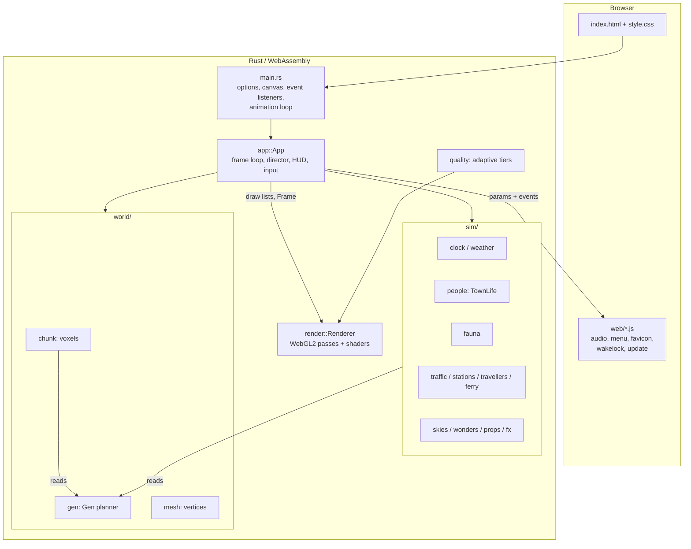
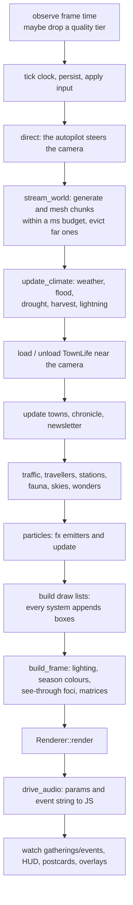

# Overview

## What it is

A single-page web app. The simulation, world generator and renderer are written
in Rust, compiled to WebAssembly (`wasm32-unknown-unknown`) with `wasm-bindgen`,
and drawn with WebGL2. A small amount of JavaScript (`web/`) provides the
soundscape (WebAudio), a touch menu, a dynamic favicon, a screen wake lock and a
"new build available" updater. There is no server component: `trunk` bundles
static files.

The program is an *autopilot*. Nothing needs input: a director moves the camera
between places worth watching, following villagers, trains, boats, weddings and
fires, while the world runs through days and seasons.

## Design principles

1. **Everything is a pure function of the seed.** `world::gen::Gen` answers
   "what is at (x, z)?" from the seed alone, so chunks can be generated in any
   order, thrown away and regenerated, and always agree with each other. The same
   seed always gives the same valley, the same towns, the same families.
2. **Time is also deterministic where it matters.** Births, weddings,
   christenings, fires, eclipses and eras are rolled from hashes of
   `(town, day, ...)`, never from a running random generator, so the director can
   *forecast* them and a town that has been out of view finds the same history
   when it returns.
3. **Only simulate and draw what is near the camera.** The terrain is streamed
   for the whole view; life (people, animals, carts, trains) is only simulated and
   drawn out to `view_r` (at most 300 units).
4. **Everything that moves is a handful of boxes.** People, trains, animals and
   particles are lists of coloured, rotated boxes (`render::boxes::Boxes`) drawn
   with one instanced draw call, not meshes.
5. **Pay only for what the hardware can afford.** The renderer compiles shaders
   with only the enabled effects in them, and steps down a quality tier when
   frame times are poor (see [Rendering](rendering.md)).

## Architecture



### The frame loop

`main.rs` runs a `requestAnimationFrame` loop that calls `App::frame(dt)`
(`src/app/frame.rs`). Each frame, in order:



The frame is split across `src/app/frame.rs` (the orchestration) and the helpers
in `src/app/frame/`: `stream.rs`, `climate.rs`, `scene.rs` (`build_frame`) and
`audio.rs` (`drive_audio`). Set `?prof` to log the milliseconds each stage takes.

### Borrowing note

`App::frame` holds `&self.world.gen` while mutating other fields (towns, fauna,
...). That is why the stages that need the generator are written inline or take
explicit arguments rather than being `&mut self` methods; the extracted helpers
(`update_climate`, `stream_world`, `build_frame`, `drive_audio`) are the ones that
do not need an `Env` borrowed from the generator.

## Source layout

```
index.html            page shell (HUD, help, overlays) loaded by Trunk
.cargo/config.toml    enables wasm simd128
Makefile              release bundle, deploy, test
web/                  JavaScript and CSS (audio engine in web/audio/)
src/
  main.rs             entry: options, GL context, listeners, animation loop
  app.rs              App struct, Director/Input/Prof types, constants
  app/                frame loop, input, HUD, director, stories, persistence, sky show
  camera.rs           orthographic isometric camera
  quality.rs          adaptive quality tiers and the effects each pays for
  names.rs            procedural names for towns and people
  util.rs, noise4.rs  hashing, RNG, noise (scalar and 4-wide SIMD)
  world/              planner (gen), chunks, blocks, meshing
  sim/                everything that changes over time
  render/             WebGL2 renderer, shaders, colour grading
```

Large modules are split into a parent file with child modules in a directory of
the same name (`app/frame.rs` + `app/frame/`, `world/chunk/sites.rs` +
`world/chunk/sites/`, and so on). Children use `use super::*;` (or
`super::super::*`) and share the parent's imports. Tests live in `tests.rs` or
`*_tests.rs` modules inside the module they test.

## Module map

| Area | Entry file | Responsibility |
| --- | --- | --- |
| Entry | `src/main.rs` | URL options, WebGL2 context, DOM/touch listeners, animation loop, hot-swap generation counter |
| App | `src/app.rs` | The `App` struct that owns everything; `Director`, `Input`, `Prof` |
| Per-frame | `src/app/frame.rs` | The frame orchestration described above |
| Input | `src/app/input.rs` | Keyboard, mouse, wheel, touch, clicking a villager |
| HUD | `src/app/hud.rs` | Toasts, villager card, newsletter, chronicle, map, postcards, share link |
| Director | `src/app/director*.rs` | The autopilot (see [Autopilot](autopilot.md)) |
| Stories | `src/app/story.rs` | Multi-day story arcs |
| Persistence | `src/app/persist.rs` | Per-seed clock in `localStorage`, time-lapse |
| Sky show | `src/app/skyshow.rs` | Rainbows, aurora curtains, shooting stars, shadow matrix |
| Camera | `src/camera.rs` | Orthographic camera, ground rectangle, view radius |
| Planner | `src/world/gen.rs` + `gen/` | See [World generation](world-generation.md) |
| Chunks | `src/world/chunk.rs` + `chunk/` | See [Chunks and meshing](chunks-and-meshing.md) |
| Mesher | `src/world/mesh.rs` | Culled faces with ambient occlusion |
| Clock | `src/sim/clock.rs` | Time of day, seasons, sun/moon light |
| Weather | `src/sim/weather.rs` | Weather kinds, wind, lightning, snow cover |
| People | `src/sim/people.rs` + `people/` | Villagers, families, weddings, gatherings, goings-on |
| Fauna | `src/sim/fauna.rs` + `fauna/` | Livestock, wildlife, boats, flocks |
| Traffic | `src/sim/traffic.rs` + `traffic/` | Trains, signals, carts and cars |
| Others | `src/sim/{stations,travellers,ferry,skies,wonders,props,fx}.rs` | See [Simulation](simulation.md) |
| Renderer | `src/render/mod.rs` + children | See [Rendering](rendering.md) |
| Audio | `web/audio/*.js` | See [Audio](audio.md) |

## Determinism and randomness

`src/util.rs` provides the primitives everything is built from:

- `hash_u32`, `hash2(seed, x, z)`, `hash3(seed, x, y, z)`: integer hashes.
- `unit(h)`: a hash mapped to `[0, 1)`.
- `perlin`, `fbm`, `ridged`: gradient noise (scalar), mirrored in
  `src/noise4.rs` as `f32x4` versions that use WebAssembly SIMD.
- `Rng`: a small PCG-style generator for *non-world* randomness (animal spawns,
  the director's choices). Anything the world must reproduce uses hashes instead.
- `lerp`, `smoothstep`, `approach` (frame-rate independent smoothing).

Hash salts such as `0xba7`, `0x7071` or `0xe7a` are arbitrary constants that give
each use of the hash its own independent stream. They are not meaningful.

## Cross-module protocols

- **`Env`** (`sim/people.rs`): a snapshot of the environment (generator, dt, clock
  time, hour, half-hour slot, rain, night, day, "nice weather", wind, season)
  built once per frame and passed to every town.
- **Sounds**: simulation code pushes `Sound { name, pos, vol, pitch }` onto a
  vector; `drive_audio` attenuates and pans them and serialises them as the
  event string the JS engine parses.
- **Draw lists**: every system has a `draw` that appends boxes to two `Boxes`
  lists, `solid` (lit, shadow-casting) and `fxb` (glow, translucent, unlit).
- **`Frame`** (`render/mod.rs`): the complete description of one frame for the
  renderer (matrices, light, colours, tints, seasonal factors, foci, rainbow,
  aurora, ...), assembled by `build_frame`.
- **`Features`** (`world/chunk.rs`): what chunks report after meshing (lamp
  positions, chimneys, fountains, forges, mill sails, wheels, beacons, bells,
  ferries, piers, treetops, steams, weirs, anglers, pasture). The voxel data is
  dropped after meshing; only features are kept.
