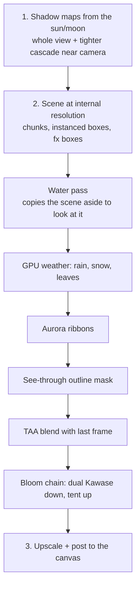

# Rendering

Code: `src/render/` and `src/quality.rs`.

WebGL2 only (the app shows a message without it). `Renderer` (`render/mod.rs`)
owns the GL context and everything on the GPU; the app feeds it chunk meshes as
they are built, two instance lists of boxes each frame, and a `Frame` that
describes the moment.

## Inputs

- **Chunk meshes** (`MeshData` from `world/mesh.rs`): `add_chunk(key, solid,
  water)` / `remove_chunk(key)`. Each chunk has a `solid` and an optional `water`
  VAO.
- **Instanced boxes** (`render/boxes.rs`): `Boxes` is a CPU list of `FLOATS = 12`
  floats per box: centre xyz, yaw, half-size xyz, material, rgb, alpha. `Rig` places
  parts relative to an object's origin and facing (`x` right, `y` up, `z` forward).
  Materials: `MAT_LIT` (0), `MAT_GLOW` (10), `MAT_UNLIT` (12), `MAT_NIGHT_WINDOW` (13).
  `alpha < 1` dissolves the box with a dither pattern (used for fading in and out).
  Two lists are drawn each frame: **solid** (lit and shadow-casting) and **fx**
  (glowing, translucent, unlit particles and beams).
- **`Frame`**: matrices (`vp`, `inv_vp`, `light_vp`, `light_vp2`), sun direction and
  colour, ambient sky/ground, sky, tints (`grass_tint`, `leaf_tint`), seasonal
  factors (`autumn`, `bare`, `blossom`, `snow`, `crop`, `ripe`, `ice`, `peak_snow`),
  weather (`cloud`, `rain`, `fog`, `flash`, `wet`, `wind`), time, `night`, `lamp`,
  window lighting `win_lit`, the nearest 16 point `lights`, `foci` for the
  see-through effect, the rainbow, aurora curtains, meteor, moon phase, `tilt` (photo
  mode), `tide` (flood/drought/ebb), colour grade parameters, camera depth range and
  focus, the `postcard` factor, particle area and brightness.

`App::build_frame` (`app/frame/scene.rs`) assembles the `Frame`. Notable pieces:
weather darkens and desaturates the light (`gloom`, an eclipse dims the sun to 7%);
the nearest 16 lamps/forges/fire glows become point lights (forges flicker);
windows light by hour (65% in the evening, 35% at dawn, 12% otherwise, more in
storms and eclipses); crops grow through spring and summer, ripen, and are
stubble after harvest; with `bounce` the ground tints the shade from green in
summer to cool white over snow.

## Pass order (`render/passes.rs`)

1. **Shadow maps**: a depth map from the sun (or moon) over the whole view, and
   on top tiers a second tighter map around the camera (`light_vp2`).
2. **Scene** at the internal (possibly chunky) resolution: chunk solids, instanced
   boxes, then the fx boxes. The water pass looks at the scene as it stands, so the
   scene is copied aside first.
3. **GPU weather**: rain, snow and falling leaves computed in the vertex shader from
   the instance number and the clock; no buffers, no per-frame uploads.
4. **Aurora**: ribbons hung in the world, added to the picture and hidden by
   anything in front.
5. **See-through outline**: marks where removed buildings would be.
6. **TAA** (top tiers at `pixel=1`): the new frame, drawn with a sub-pixel wobble,
   blended with last frame's result reprojected through the depth and clamped to the
   colours nearby so nothing ghosts. Reprojection leaves the jitter out so a still
   view reads the same texel every time.
7. **Bloom**: a chain of ever blurrier, smaller copies of what is bright (dual
   Kawase down, tent filter up).
8. **Post** to the canvas: upscale (undoing the sub-texel shift), SSAO, light
   shafts, depth of field, tone mapping, colour grading, chromatic aberration,
   fog, etc., depending on the tier. Zoomed far out, occlusion and blur are skipped
   because every terrace is a texel or two across and they would just smudge.

Sampler units are all bound each frame whether or not used, to avoid undefined
reads.

## Shaders (`render/shaders/`, `render/programs.rs`)

GLSL ES 3.00 source strings in Rust. `common.rs` has shared code substituted in
at compile time: `COMMON` (uniforms, helpers), `SWAY` (foliage sway, shared by the
colour and shadow passes so leaves never shadow themselves as they move), `BAYER`
(ordered 4×4 dither for screen-door fading). The files:

- `world.rs`: chunk vertex/fragment shaders (`CHUNK_VS/FS`), the `OCCLUDE` snippet
  shared by the scene and mask shaders (drops building/tree fragments between the
  eye and whoever is watched), `MASK_FS`, and the water shader (`WATER_VS/FS`).
- `instanced.rs`: box shaders and their shadow variants (dither-fading boxes also
  dissolve their shadows).
- `particles.rs`: GPU rain/snow/leaves.
- `aurora.rs`: ribbon slices built in the vertex shader from a few uniforms.
- `post.rs`: the post chain, bloom down/up, TAA.

`programs.rs` compiles them **against the current `Fx`**: what is off is not
compiled in, so it costs nothing. The seasonal look (spring blossom, summer
green, autumn colours and falling leaves, bare winter trees, snow cover) is done in
the chunk shader from the material id and the `Frame` seasonal factors, so nothing
is re-meshed as seasons change.

## Targets and resizing (`render/targets.rs`)

Shadow targets, the scene target (HDR on tier 0) and auxiliary buffers (previous
frame for TAA, bloom mips, copies for water) are created at the scene size.
`pixel` (1 = crisp, higher = chunkier) sets the internal resolution relative to the
canvas; `extra_pixel` adds chunkiness at the lowest tiers.

## Colour grading (`render/grade.rs`)

The look of the time of day and season is baked into a 16³ 3D lookup table read once
per pixel. Parameters (golden-hour warmth, night, winter, overcast) are quantised to
1/24 steps; the table is rebuilt only when they move far enough.

## Adaptive quality (`quality.rs`)

`Quality { tier, auto, … }` with tiers 0 (Ultra) … 5 (Minimal). `observe(dt)`
watches frame times: it ignores the first 6 seconds of start-up (`WARMUP`) and stalls
over 0.5 s (hidden tabs), measures over 2.5-second windows, and after two slow
windows in a row (`STRIKES`; average over 24 ms, or 45 ms under the 30 fps cap)
steps down a tier and lets things settle for 2 seconds. **It never steps back up**,
so it cannot flap. A badge in the corner names each new level.

| Tier | Name | Effects (`Fx`) |
| --- | --- | --- |
| 0 | Ultra | HDR + bloom, cascades, SSAO (14 taps), light shafts (14), DoF, TAA at `pixel=1`, grade, sky with stars and clouds, water with caustics and reflections, chromatic aberration, sun-lit fog, cloud shadows, material detail, bounce light, 60 000 GPU particles, distance-muffled sound |
| 1 | High | SSAO and rays at 8 taps, grade, sky, water depth/foam/caustics, CA, fog, clouds, materials, bounce, 30 000 particles, air |
| 2 | Medium | grade, gradient sky with sun and moon, water sky reflection, fog, clouds, materials, bounce, 15 000 particles, air; capped at 30 fps |
| 3 | Low | grade, sky, clouds, materials, bounce; +1 pixel scale, 30 fps |
| 4 | Very low | grade and bounce; +2 pixel scale, 30 fps, mesh budget 3 ms |
| 5 | Minimal | nothing extra; no shadows; +2 pixel scale, 30 fps, mesh budget 3 ms |

Other per-tier numbers: shadow map 2048 (tier 0), 1024 (1–4), none (5); shadow taps
4/1/0; frame cap 30 fps from tier 2; mesh budget 7 ms (3 ms from tier 4). `fxoff`
turns individual effects off whatever the tier says (see [Usage](usage.md)).

## Other renderer notes

- `antialias` is off on the context; `powerPreference` is high-performance.
- TV browsers start at tier 1 when the quality is `auto`.
- Photo mode (`O`) stops time and uses a tilt-shift blur; `Enter` saves a PNG via
  `meepleUi.snap()` (`web/menu.js`) right after drawing a frame so the canvas
  still holds it.
- `gl.rs` has thin helpers for programs, buffers and uploads.
