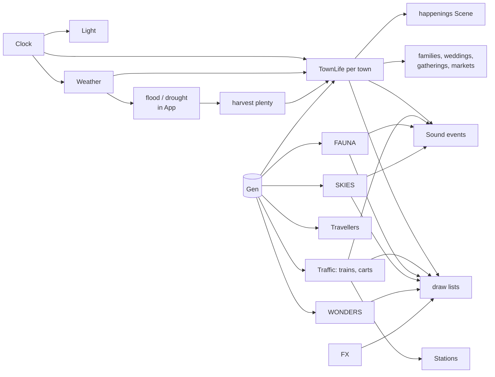

# Simulation

Code: `src/sim/`. Everything here is *life*: it exists only near the camera, is
created and destroyed out of sight, and draws itself as boxes.

## Clock (`clock.rs`)

`Clock { days, day_len, speed }`. `days` is the elapsed in-game days (fractional).
`day_len` is real seconds per game day (default 1200, `?day=`); `speed` is the
`T` multiplier (1, 6, 30, 120). A season is `DAYS_PER_SEASON = 3` days, so a year is
12 days. `season()` is 0..4 (spring, summer, autumn, winter, fractional).

`light()` produces the `Light` for the moment: sun/moon direction, sun colour,
sky and ground ambient colours, sky colour, and `night` (0 full day … 1 deep
night). Sunrise/sunset move with the season (`sun_times`, earlier and later in
summer), the sun's maximum elevation is higher in summer, twilight adds warm
tints, and the moon has an eight-day cycle (`moon_full`); a full moon lights the
night more.

## Weather (`weather.rs`)

`Weather` is a slow random walk between six kinds: Clear, Cloudy, Rain, Storm,
Fog, Snow. Each kind has target values for `cloud`, `precip`, `storm`, `fog`; the
live values ease towards the targets. Season-dependent odds (`pick`) decide the
next kind (for example snow only in winter, storms mostly in summer, fog in autumn
and winter). A new kind lasts 100–260 seconds and picks a new wind. `R` cycles
kinds by hand.

Also: `wind` (vector), `flash` (lightning), `thunder` (delayed claps returned to
the caller as volumes), `snowing` (precipitation falls as snow when cold enough),
`ground_snow` (cover accumulates and melts), and `wet` (wet ground, which gives
sheen and steam after rain).

`App::update_climate` layers longer-term state on top:

- **Flood**: sustained heavy rain (non-snow) raises `flood` (0..1); it drains away
  after. Rivers and water level rise with it (the `tide` value).
- **Drought**: weeks of fine weather in the warm months raise `drought`, which lowers
  rivers and raises fire risk; rain brings it back.
- **Harvest plenty** (0.2–1.6): a year's luck hashed from the seed and year,
  helped by autumn and hurt by drought or flood. It feeds `set_plenty` on towns and
  traffic (heaped market stalls, loaded carts) and writes a chronicle line in autumn.
- **Lightning**: a strike during a storm may set a house alight (20% chance per
  town, one per strike); fire risk is scaled by drought and storm.

## Villagers (`people.rs` and `people/`)

Each town near the camera has a **`TownLife`**: its lots, a list of `Person`s,
dogs, cats, chickens, and the town's current gathering, wedding, game, visit
promise and `happenings::Scene`. Towns are created when they come within range
(`view_r + 90`) and dropped when they leave, except the town being followed.

### People

A `Person` has a name (`names.rs`), a `Role`, a home and optionally a workplace
(lot indices), position and path, a state machine and many small timers. Looks
(shirt, trousers, skin, hair, hat, umbrella colour, scale) are drawn from
palette tables.

**Roles**: Farmer, Baker, Barkeep (innkeeper), Smith, Shopkeeper, Priest (vicar),
Teacher, Librarian, Postie, Villager, Child, Elder. Trades come from the lot kind
(`setup.rs`): tavern → barkeep, bakery → baker, smithy → smith, shop →
shopkeeper, church → priest, school → teacher, library → librarian, farm →
farmer; each home also gets villagers, children, elders and a postie.
Only finished houses have residents.

**States**: Inside, Walking, Idle, Working, Sitting, Chatting, Dancing, Singing,
Playing. **Emotes**: Talk, Heart, Note, Laugh.

### Daily schedule (`goals.rs`)

`want(person, env)` chooses a `Goal` from role, hour, weather and a per-half-hour
dice roll (`env.slot`). Goals: Home, Work, Tavern, Errand, Visit, Plaza, Play,
Bench, Gather, Market, Shop, Deliver, Wedding, Gym. Highlights:

- Workers: work 8–12 and 13–17:30, home before 8, lunch at the inn/plaza/home,
  evenings at the inn (up to 38%), the plaza, a friend's house or home.
- Children: school on weekday mornings (day % 7 < 5, 9:00–14:30); otherwise play
  in the plaza, home before 8 and after 19:30 or in wet weather.
- Elders: bench, plaza, errands, home early and in wet weather.
- The **postie** goes round the houses 8–12; the **baker** takes bread to the inn
  9:00–9:42.
- **Market** every third day: stallholders mind stalls, others browse with baskets.
- Evenings: those who said they would come go to the **gathering**; children are
  home by nine.

`dest_for` turns a goal into a destination (`Lot`, `Field`, `Anvil`, `Plaza`,
`Bench`, `Gather`, `Stall`, `Gym`).

### Movement (`routing.rs`, `behaviour.rs`, `behaviour/motion.rs`)

Walkers follow paths over the street grid (`street_path`), step aside for carts
and other people (`LOOK_AHEAD`, `PASS_WIDTH`), keep clear of the fountain
(`FOUNTAIN_CLEAR`), and give up on a blocked waypoint after `STALL_TIME` seconds
(`STALL_RADIUS`). People fade in and out of doors (`fade`) so they never pop.
`think` runs the goal re-evaluation when a slot changes; `arrive` handles what to do
on reaching a destination (go inside, start working, sit, chat, shop). Chats pair
people up at `CHAT_DISTANCE` with emotes and babble sounds in their pitch
(`Person::voice`).

### Families (`family.rs`)

Households share a surname. A household's births depend only on its house and the
day (`birth_days(lot_seed, first, upto)`: 14 births per thousand days for two
grown-ups, at least 20 days apart, a maximum household of six), so a town that has
been out of view finds the same families, one year older, when loaded (`HISTORY` is
400 days of back-history). Babies spend `BABY_DAYS = 7` in a pram; then they are
children; a grown child may take over a parent's trade (`inheritable`: only trades
that are not one-per-town). `family_lines` produces the "kin" lines on a villager's
card.

### Weddings (`wedding.rs`)

On a fine day in a city a couple of villagers may marry (`WEDDING_CHANCE = 0.14`).
The party sets off at 13:00, the ceremony is in church, the couple come out
married to bells and petals at about 14:12, then there is a dance in the plaza until
about 16:24. Afterwards the bride moves in with the groom. The day's wedding can be
forecast by the director from the same dice (`forecast`).

### Gatherings (`gathering.rs`)

Each fine evening a town has a 40% chance (`GATHER_CHANCE`) of an evening
gathering, 19:00–22:24, if at least `MIN_TURNOUT = 5` villagers will come. The
first to arrive plays; most dance round a ring (`DANCE_RING`) and some sing
(`SING_RING`). The gathering's character follows the season (`Festival`): **Maypole**
(spring), **Midsummer** (summer), **Harvest** (autumn: hay bales, pumpkins), **Bonfire**
(winter: lanterns and a bonfire). Children play tag, catch or skipping (a new game
every half hour).

### Visits (`visit.rs`)

When the autopilot decides to travel to a festival, wedding, christening or fire,
it **promises** the town it is coming (`Visit`). The town makes sure the occasion
happens (a little drizzle or a thin turnout will not stop it) and holds the start
until the camera is near, so the camera never arrives to an empty square.

### Interiors (`interior.rs`)

With the camera zoomed right in and someone at home, the nearest house is laid
open like a doll's house: roof cut away by the see-through effect, a furnished
ground-floor room (rug, table, bed, hearth fire) and whoever is at home going about
it. Not while a house is on fire (`I` turns it off).

### Pets and farm animals (`animals.rs`)

About 12% of non-child villagers have a dog, 15% a cat; farms have chickens. Dogs
follow, bark and get chased across the square in the "chase" event; cats keep their
own counsel; chickens cluck.

### Descriptions (`describe.rs`)

Text for the UI: what someone is doing in words, how interesting they are to
watch (`interest`), the villager card (name, role, home, kin, friends, activity),
and the day's village newsletter ("Today in ...").

## Goings-on (`people/happenings.rs` and children)

Events beyond individual routines. The people in them are **extras**: drawn where
the event says, with no minds of their own, so nothing can disturb the villagers.
Each `Kind` event (`Fire`, `Christening`, `Chase`, `Doctor`, `Closing`) has a daily
(or hourly) chance and an `Active` instance (start time on the real clock, duration,
route, lot). Chances: fire 7%, christening 14% (cities, fine weather), chase 12%,
doctor's rounds 22%, closing time 70%.

| Event | What happens |
| --- | --- |
| Fire | A house catches fire (or is struck by lightning); the brigade runs a bucket chain to it; soot marks the house afterwards |
| Christening | A procession to the church with the baby |
| Chase | A dog is chased across the square |
| Doctor | The doctor's rounds of the houses |
| Closing time | Drunks stagger home from the inn at 23:00 |
| Fair | Travelling fair on the green for `FAIR_DAYS = 2` every `FAIR_EVERY = 36` days (not in winter): a carousel, a ferris wheel, a strongman's tower and bell, stalls, bunting, a calliope and strolling visitors; fireworks in its last hour |
| Cricket | Summer afternoons on the green: a pitch laid cell by cell, bowler, striker, fielders and keeper, a ten-second ball cycle, spectators on the rope and a tea tent |
| Skating | Winter, on the frozen green (a rink) |
| Snow play | Winter: children build snowmen through the morning and split into two sides for a snowball fight after noon |
| Chores | The farming year's work on the fields |
| Lamplighter | Lights the street lamps at dusk (and puts them out at dawn); a fiddler plays at the inn door |

`forecast(town, day, season)` is the public prediction of a town's day: a list of
`Forecast { weight, from, to, why, fine_only, occasion }`, used by the director to
pick destinations and to build story arcs. Each entry uses exactly the same hash
as the event itself.

The scene also keeps a `log` of what happened (feeds the chronicle), soot marks,
and `risk` (scaled by drought/storm). Source files: `logic.rs` (scheduling and
ambient sounds), `figures.rs` (shared figure drawing: garb, poses, props),
`draw_events.rs`, `draw_venues.rs`, `draw_life.rs`.

## Fauna (`fauna.rs` and `fauna/`)

`Fauna` holds groups keyed by chunk, bird flocks, deer herds, and narrowboats.

- **Groups** (`spawn.rs`) are created per chunk entering view from the chunk's
  `Features`: **Sheep** and **Cows** on pasture, **Ducks**, **Swans** and
  **Herons** on water, **Deer**, **Foxes** and **Rabbits** (shy, dawn and dusk),
  **Owls** (night, perched on treetops and flying between them), **Wolves** (cold
  north, dusk and night; deer give them a berth), **Salmon** leaping at weirs
  in autumn, **fishing boats** moored at harbour piers from dusk. Groups created
  while their spot was on screen start `hidden` and only appear once the camera
  looks away, so animals never pop in. A group has an `active` level (0..1) so wild
  animals fade in at their hours.
- **Herds** (`herds.rs`): migrating deer cross the country in a long loose line,
  north in spring and south in autumn.
- **Flocks** (`flocks.rs`): birds crossing the sky by day; in autumn and spring
  great skeins (10–22 birds) head south/north.
- **Boats** (`boats.rs`): narrowboats working the canals, in from out of sight,
  turning round where the canal ends, in random colours.
- **Owls** (`perch.rs`): sit on a treetop (lower down the bare trunk as leaves
  fall) and swoop to another now and then.
- **Ecology** (`ecology.rs`): wildlife numbers rise and fall.
  - `abundance(seed, kind, pos, days)` (0.1..1) is a pure function of the seed,
    place and date, so a world looks the same whenever it is loaded. Each
    320-unit region has its own phase. **Rabbits, deer and ducks** follow a
    9-day boom and bust and are 30% leaner in winter; **foxes and wolves** follow
    the same wave `PREDATOR_LAG` (1.4 rad, a bit over a quarter cycle) behind,
    so a lean year for prey is followed by one for predators. **Salmon** run
    strongly or poorly year by year (12-day years). Other kinds are always at
    full strength.
  - A group's `density` eases toward it (`approach(0.2, dt)`) and its `loss`
    (animals killed lately) heals at 0.03 a second; `Group::shown()` is how many
    of its animals are out, and the drawing, `sights()` and the hunt use only
    those. A scarce predator can vanish for a spell.
  - **The hunt** (`tick_ecology`): a hungry fox sees rabbits within 14 units and
    a wolf sees deer within 22. It chases the nearest at a sprint, and rabbits
    near a fox bolt. Closing within 0.9 units is a kill: the quarry's group
    takes a `loss` of 1 and the hunter is `fed` for 30 seconds. Hunters work only
    at their hours (`active > 0.5`) and only on animals that are in view range
    and not hidden.
  - `Fauna::wildlife_report(pos)` is the newsletter's "Wildlife:" line (rabbits,
    foxes and deer as scarce, fair or plentiful, plus the salmon run in
    autumn). The app calls `set_day(clock.days)` each frame.
- `sights(view, reach)` reports things worth looking at for the director.
- Shy animals bolt from villagers, carts and trains (`threats`).

## Traffic (`traffic.rs` and `traffic/`)

### Trains

`Traffic` runs **steam trains** on railway lines. A `Train` has a locomotive
(`Front`: either on a line at distance `s`, direction `dir`, or on a junction
`Chord`) and a set of `Car`s (locomotive, coaches, freight, log wagons). Cars
follow the locomotive's *trail* (a recorded polyline of its past positions at
`TRAIL_STEP = 0.5`), so they go round junctions the way the engine did, with
spacing `CAR_SPACING = 4.7`. Trains cruise at `CRUISE = 9`, ease to
`JUNCTION_SPEED = 5.5` through a junction curve, and stop at stations along their
line (`stations_for`).

**Signals and points**: each crossing (and its junction curve) is a **block**
(`BLOCK_R = JUNCTION_REACH + 6`): only one train at a time. `signals()` is the
signalman: a train nearing a block gets the road if it is free (nearest first),
otherwise its semaphore signal stays at danger and the train brakes
(`SIGNAL_BRAKE`) to stop at it; drivers see a signal `SIGNAL_SIGHT = 70` away.
Each train deterministically takes or skips a given junction (`takes`), and the
points are set accordingly. Passing loops serve the same purpose. Semaphores clunk
when their arms move.

### Carts and cars

Horse carts (`carts.rs`) travel town-to-town roads (`spawn_cart` appears at
the last point before the path comes within view reach), with a driver, cargo
(loaded by harvest plenty), hoofbeats, and a pause at journey's end before
returning. From **era 2** (the third age) motor cars replace carts. People step
aside for carts (`cart_obstacles`).

## Stations (`stations.rs`)

One `Station` per rail town (`Stations::sync`), keyed by town. Passengers (with
a suitcase, a carpet bag, or nothing) walk onto the platform to a free spot and
wait; when a train stops they board and vanish into a carriage door; others get
off and head for the exit; the guard waves a green flag before the train leaves.
Counts of boarded and alighted passengers feed the newsletter. The platform runs
from `s-4` to `s+3` with canopy posts, a bench and lamps along the back.

## Travellers (`travellers.rs`)

Parties on the roads between towns: a **peddler with a donkey**, a **string of
pilgrims**, a **shepherd driving a flock with his dog**. At most `MAX_PARTIES = 6`
near the view; they walk roads (appearing and vanishing out of sight), step aside
for others, and rest at the far end before turning round. The autopilot can walk
with them (`Mode::FollowTraveller`).

## Ferries (`ferry.rs`)

A flat barge hauled hand over hand along a chain between plank landings, speed
`0.9`, waiting `11` seconds at each quay. Every other crossing carries something
different: passengers or crates. Carts and travellers wait at the quay.

## Skies (`skies.rs`)

- **Eras**: `era(seed, first_day, day)` returns 0, 1 or 2 — "the age of horse and
  lantern", "the age of steam and telegraph", "the age of motor and electric
  light". A world starts in a seed-dependent age and moves on every `ERA_DAYS = 36`
  days. The era gates **telegraph poles** along railways (age ≥ 1), **motor cars**
  (age 2), and contributes to what flies.
- **Aircraft**: airships, biplanes, and striped **hot air balloons** (still mornings
  and evenings, drifting in groups, burners roaring every 9 seconds for 1.3 s).
- **Eclipse**: `Skies::eclipse(seed, days)` — a rare total eclipse at noon every
  month or so, dimming sun, ambient, and lighting windows.
- **Telegraph**: poles with wire, and messages that run as sparks along the wires.

## Wonders (`wonders.rs`, `wonders/places.rs`)

The moving parts of the countryside sites:

- Camel caravan at the **oasis**; **geyser** eruptions (`ERUPT_EVERY = 48`,
  `ERUPT_FOR = 8` seconds); **ski lift** with chairs up one side and down the other and skiers carving down the piste on the premade run;
  **mine** winding wheel and ore trucks cycling out of the tunnel; midsummer and
  midwinter **sunrise** through the standing stones' trilithon onto the altar stone;
  **foghorn** at the lighthouse in fog; steam off hot springs.
- `places.rs`: **orchard** (pickers on ladders in autumn daylight, ripe apples),
  **apiary** (bees in warm weather, beekeeper, honey stall), **monastery** (bell at
  dawn, noon and dusk, monks in the cloister), **shrine** (lamp burning at night, a
  pilgrim at prayer), **camp** (tents, caravan, fire, travellers round it at dusk),
  **hill fort** (sentry, pennant, lamps at dusk), **haunted ruins** (most ruins:
  cold lights wander after dark; now and then a pale figure walks the arch).

## Props (`props.rs`)

Windmill sails (turn with the wind; the angle is accumulated frame by frame
because rate × clock would whirl when the wind changed), water wheels (rings of
paddles), lighthouse beams (two shafts sweeping round at night), anglers on river
banks (rod, line, bobber; a bite makes the tip dip), and the water running over
weirs (streaks, glassy lip, curtain, droplets, foam and mist).

## Particles and effects (`fx.rs`)

`Fx` is a CPU particle system (capped at `MAX_PARTS = 2500`) for **chimney smoke**,
**fountain spray**, **forge and anvil sparks**, **fire smoke**, **fireworks**
(rockets that climb then burst into coloured sparks, with a `boom` sound), and
**steam**. Stateless ambient effects (rain, snow, fireflies, butterflies, falling
leaves) are anchored to world tiles of `TILE = 48` and driven by hash and clock;
on the GPU tiers rain, snow and leaves are computed entirely in the vertex shader
(see [Rendering](rendering.md)).
