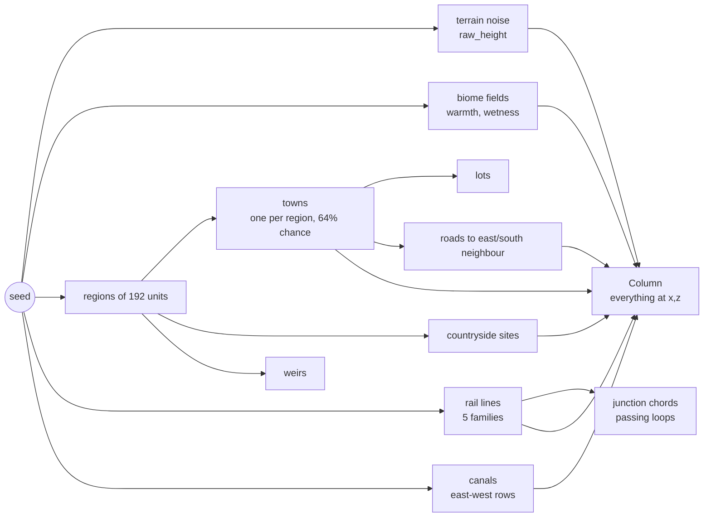

# World generation

Code: `src/world/gen.rs` and `src/world/gen/`.

`Gen` is the **planner**: an object built from the seed that answers questions
about the world at any point. It holds no voxels and no history; it is a pure
function of `(seed, position)` plus memoisation caches (`RefCell<HashMap<..>>`
fields for towns, lots, rail nodes, chords, loops, greens, sites, weirs, canals,
bridges and ferries). Because every answer depends only on the seed, chunks can
be generated in any order and still agree about where a road or river runs.

Two `Cell`s are the only mutable "world state": `day` and `first_day` (the day
the world was first seen), which drive house construction and decay (see
[Lots and construction](#lots-and-construction)).

## Key constants (`gen.rs`)

| Constant | Meaning |
| --- | --- |
| `SEA = 12` | Sea level in voxels. Water surface is at `SEA`. |
| `MAX_H = 54` | Highest terrain height. |
| `REGION = 192` | Size of a planning region. Towns, sites and weirs are placed per region. |
| `STREET = 11` | Spacing of a town's street grid. |
| `RIVER_WIDTH` | How wide rivers are, in river-noise units. |
| `RAIL_FAMILIES = 5`, `RAIL_SPACING = 1800`, `RAIL_JITTER = 260` | Railway lattice. |
| `FERRY_SPAN = 10`, `FERRY_MAX = 30` | A road over water this wide is a ferry rather than a bridge; longer than `FERRY_MAX` is left to a bridge. |
| `CANAL_SPACING = 250`, `CANAL_MAX_RISE = 8` | Canal rows and how high above the sea a canal may be dug. |
| `JUNCTION_CHANCE = 0.75`, `LOOP_*` | Railway junction chords and passing loops. |
| `BUILD_DAYS = 3`, `GROWTH_DAYS = 70`, `NEW_BUILD_CHANCE`, `DECAY_CHANCE` | House construction timeline. |

## Terrain (`gen/terrain.rs`)

`raw_height(x, z)` is the continuous terrain height before anything is built on
it:

1. **Continents/base**: `fbm` at 700-unit scale sets the base level around the sea.
2. **Hills**: 150-unit `fbm`, ±8.
3. **Detail**: 38-unit `fbm`, small.
4. **Mountains**: a ridged noise field masked by a very low-frequency `mmask`
   (950-unit scale), only where the base is already high.
5. **Terracing**: the height is blended 55% towards a stepped version (steps of
   3 with smooth risers) for a hand-made, tiered look.
6. **Rivers**: `river(x, z) = |fbm(560-unit)|`, near zero along a river's
   course. Near zero the height is pulled down to `SEA - 2.5`, less so in the
   mountains.
7. Clamp to `[2, MAX_H]`.

`raw_height4` is the same arithmetic on `f32x4` (see `src/noise4.rs`), and
`noise_block` evaluates heights and the two biome fields for a whole rectangle
of columns four at a time. The chunk generator uses it so terrain noise is the
hot path vectorised.

### Biomes

`Biome` is `Plains | Forest | Desert | Tundra | Mountain | Jungle`. Two slow noise
fields, warmth (1100-unit) and wetness (800-unit), pick it:

- height above `SEA + 20` → `Mountain`;
- adjusted warmth `t = warmth - (h - SEA)/90`; `t > 0.17` and dry → `Desert`;
  hot and wet (`t > 0.1`, wetness > 0.1) → `Jungle`; `t < -0.2` → `Tundra`;
  wet (> 0.1) → `Forest`; otherwise `Plains`. Jungle is the rarest lowland
  biome (about 3% of dry land), and only ever claims warm, wet ground that
  would otherwise have been forest or plains.

**Jungle** (`chunk.rs`, `chunk/trees.rs`): trees are dense (probability
`0.9 - clearing·1.1`) and are 70% **kapoks** (7–10 high with buttress roots and
a wide flat crown) and 30% **palms** (5–7 high, four fronds). Both register
treetops for the owls. The ground is lush with tall grass, bushes and the odd
flower. The HUD calls it "Jungle", the autopilot visits it ("Deep in the
jungle") and the music uses the forest scale. Jungle isn't pasture, and orchards
and chalk figures (plains and forest only) are not found there.

`coldness(x, z)` (0 warm … 1 frozen) is derived from the same warmth field and
drives northern building style, wolves, aurora, snow cover, and weather.

## Columns

A `Column` is everything the planner knows about one `(x, z)`: height `h`,
biome, the town it belongs to, rail line/offset on the track bed, junction
chord, site/quarry flags, canal offset, viaduct or tunnel level, road, street
and plaza flags. `column_with(ctx, x, z, raw, tn, mn)` computes it from
already-evaluated noise. The `Ctx` (`towns`, `roads`, `rails`, `chords`,
`sites`, `canals` near a rectangle) is built once per chunk by `Gen::ctx` so
columns do not repeat the spatial queries.

Column construction applies, in order: canals (a level channel with a towpath
on each side), railways graded into the land, junction chords, countryside
sites (levelling under buildings, stepping a quarry down, a ski resort's
premade run, sinking a pool, a watermill's water race), and finally the village
green (levelled flat so the cricket pitch and the skating rink sit on level
ground).

## Towns (`gen/towns.rs`, `towns/roads.rs`, `towns/lots.rs`)

- One potential town per **region**: `hash2(seed ^ 0x7071, rx, rz)`; 64% of
  regions have a town. Its centre is jittered inside the region (64-unit
  margin) and nudged away from any railway so the plaza stays clear
  (`PLAZA_RAIL_CLEAR = 18`). Towns that would sit on a canal or too close to a
  railway are dropped.
- A quarter of towns are **cities** (radius 38–51); the rest are villages (radius
  24–35).
- **Style** comes from where the town sits, tried in this order: `Northern`
  (cold), `Tropical` (the centre is in a jungle), `Highland` (mountain/high),
  `Mediterranean` (very warm, `warmth > 0.22`), `Coastal` (near water), else
  `Lowland`. Style picks walls, roofs and so on.
- **Names** come from `src/names.rs`.
- **Greens**: `green(t)` finds a level, open spot just outside the town (eight
  directions tried) for fairs, cricket and skating; `green_clear` keeps trees and
  sites off it (`GREEN_R = 14`).
- **Roads**: each town links to the next town to its east and the next to its
  south (looking up to two regions out). `road_path` leaves each town along its
  own street line then wanders in a long S-bend whose shape is hashed from the
  pair of town ids. Straight legs become whole `Seg`s; slanting legs become
  chains of dots. `roads_near` collects the segments in a rectangle (looking two
  regions further each way because roads bend).
- **Stations**: a town on a railway line gets a station box/position
  (`station_box`, `station_s`).

### Lots and construction

`make_lots` lays an 8×8 lot on every street cell of the grid within the town
radius, skipping the four central cells (the plaza), lots near railways or
junction chords, and lots hit by other towns' roads. Candidates are sorted by
distance from the centre, and the **kind** is assigned by order and chance:

| Rank / rule | Kind |
| --- | --- |
| 1st, 2nd, 3rd nearest the centre | Tavern, Bakery, Smithy |
| 4th | Church (city) or Shop |
| 5th | Shop (city) or School |
| 6th (city) | School; 7th (city) Library |
| outer 45% of a village, 60% chance | Farm |
| inner 62% of a city, 70% chance | Apartment |
| 7% | Garden |
| otherwise | House |

Walls and roofs depend on kind and style (taverns are plank, or log in the
north; churches and libraries are stone; highland houses are rubble or
cobble under slate; coastal houses are plaster under blue roofs; Mediterranean
houses are whitewash, ochre or pink plaster under terracotta (`ROOF_RED`) and
brown roofs; tropical houses are plank, log or ochre plaster under green and
brown roofs; and so on).
Each lot has a facing (towards the centre), a door, a front spot and a street
spot. Floors: apartments 3–5, taverns/libraries/manors 2, city houses 1–2, a
quarter of village houses 2.

**Construction over time.** A lot's `stage(first_day, day)` is
`Vacant → Plot → Frame(0..1) → Done`, and later maybe `Ruin`. When the world is
first seen most houses are `Done`; a few (`NEW_BUILD_CHANCE`) are still going up
and are finished over the following days, and new houses go up over `GROWTH_DAYS`
(70) days. A small share (`DECAY_CHANCE`) is abandoned at some later day and
becomes a `Ruin` (crumbling, ivy). The number of residents per lot kind is in
`Lot::residents` (houses 1–3, apartments 2 per floor, shops/taverns/schools 1).

## Railways (`gen/rail.rs`)

Railways are **infinite lines** at one of five angles (families), fanned evenly
and turned by a seed-derived amount so every world differs. The *k*th line of a
family sits at `k * 1800 + jitter(±260)` across, and is bent by a seed-derived
gentle meander (±`RAIL_BEND_MAX = 60`). Lines cross at all sorts of angles.

- **Level**: `rail_level(x, z)` is a smooth height field the lines follow, and
  `rail_bed` is the integer bed height. Track rides *on* the land; where the
  ground is far below it (`VIADUCT_RISE = 4.5`) it crosses on a **viaduct**; far
  above (`TUNNEL_DEPTH = 7.5`) it goes through a **tunnel**; a line over water is
  always on a viaduct.
- **Junction chords** (`Chord`): at 75% of crossings a curved length of track
  leaves one line before the crossing and joins the other after it
  (`JUNCTION_REACH = 40`). A **passing loop** is a chord from a line back onto
  itself (one per `LOOP_PERIOD = 420` of line, 80% chance, 170 long, 6.5 off
  the main track), only on open level dry ground clear of towns, canals and
  crossings.
- A line that passes a town is its station line: stations stand beside it.

## Canals (`gen/canals.rs`)

Canals run **east-west**, in rows spaced `CANAL_SPACING = 250` apart. A canal is
dug only through low land (≤ `CANAL_MAX_RISE = 8` above the sea) between two
stretches of open water: judged in samples cached in 64-wide tiles, with runs of
40–2400 samples. It never goes across water or ends blind in a field. A channel
is level with a towpath either side; railways crossing a canal are on a viaduct.
`water_near(town)` looks outward from a town for the nearest water (to put a
harbour or lighthouse).

## Countryside sites (`gen/sites.rs`)

`SiteKind`: Windmill, Manor, Ruin, Quarry, Watermill, Lighthouse, Harbour,
Mine, StoneCircle, ChalkFigure, Geyser, Oasis, SkiResort, Monastery, Shrine,
HillFort, Camp, Orchard, Apiary.

`sites(rx, rz)` plans a region's sites with a strict rule that no two share
ground (a jetty needs only a little room). It tries, in order:

1. **By the water**: a harbour with jetty and a lighthouse along the shore on a
   lake or sea; a watermill on a river bank (60% of regions with a river,
   `MILL_CHANCE`), with a water race for the wheel.
2. A **windmill** in the fields just outside a village (clear of the green).
3. **Quarries** on high stony ground, **manors** on gentle hills, **ruins**
   anywhere.
4. **Rarer wonders** by the lie of the land: geysers in the cold high country,
   oases in deserts, standing stones and chalk figures, mines in the hills.
5. A **ski resort** where a mountainside rises evenly along one of the four
   axes (14–32 rise over the run, level either side, nothing in the way): its
   premade run is laid in its own frame (`u` up the slope, `v` across) over a
   corridor `SKI_HALF_LEN = 42` × `SKI_HALF_WIDTH = 17`, blended into the land
   for `SKI_BLEND = 9` more.
6. **Quiet places** of temperate land: monasteries on gentle hills, hill forts on
   the heights, shrines and travellers' camps.
7. An **orchard** or **apiary** in the fields just outside a village.

`site_clear` / `standing_clear` check a spot is dry and off roads, rails, canals
and towns; some sites are allowed beside a village.

## Weirs (`gen/weirs.rs`)

Each region has 1–2 weirs (85% chance of any) on a river: a stone sill from bank
to bank in the deep middle of the river's course, with its cross and downstream
directions. They keep away from region edges and from watermills. They are placed
per region but belong to the chunk their middle is in.

## Bridges and ferries (`gen/terrain/ferries.rs`)

A road crossing water is a **bridge** unless the water is `FERRY_SPAN` (10) cells
wide or more, in which case it is a **chain ferry** between plank landings
(provided the crossing is at most `FERRY_MAX` and the road does not wander more
than `FERRY_STRAY` from the line between landings). `banks` measures the distance
to the nearest bank along the road (capped at `BANK_CAP = 12`);
`bridge_deck` gives a deck level and distance; `ferry_runs_near` / `ferry_at` /
`is_ferry` expose crossings; `walk_y` gives the height a walker's feet should be
at (over a bridge deck, a ferry or the ground); `dry_part` trims a path to its dry
sections.
